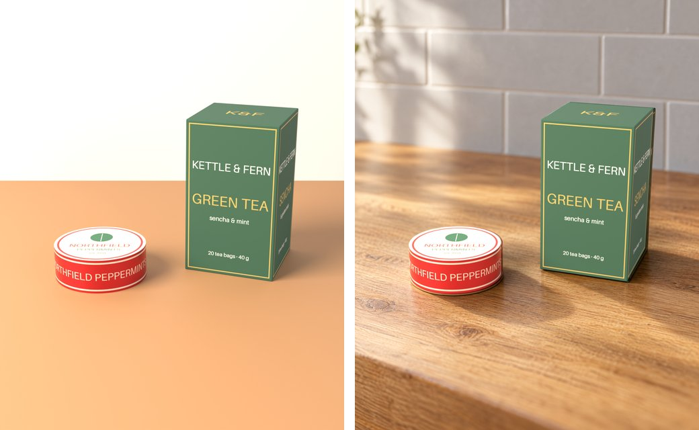

# layoutfirst

Product ads where **Blender owns the product and an image model paints only the room around it.**

Image models are good at rooms, light and mood, and bad at your product: they redraw logos, misspell labels and change sizes. layoutfirst never lets them touch it. Your product is a 3D model wrapped in your own photos. Blender places it, the image model repaints everything else as a real photo, and the exact product pixels go back on top. Every run checks that not one product pixel changed.



*Left: the Blender layout. Right: the finished image. The tin and the box are the same pixels in both.*

## Quickstart

You need [Claude Code](https://claude.com/claude-code), Python 3.10+, and an OpenAI or Gemini API key, on macOS (Apple silicon) or Linux. Blender is downloaded into the folder for you if it's missing. On Windows, use WSL or install Blender yourself.

```bash
git clone https://github.com/<org>/layoutfirst
```

```bash
cd layoutfirst && claude
```

Then, inside Claude Code:

| Command | What happens |
|---|---|
| `/setup` | Installs everything, asks you to paste one API key into `.env`, and makes a demo ad so you can see it work (about 3 minutes, about $0.09). |
| `/new-product` | You drop photos of your product in a folder. Claude builds the 3D model and shows it next to your photos to check. |
| `/make-ad` | Describe the ad in plain words. You get the finished image, the steps, and what it cost. |

## How it works

1. **Blender layout.** Your product model, camera, framing and product lighting. The room is a rough guide. Three renders come out: the whole scene, the product with the shadows it casts, and a product mask.
2. **Mask.** The product outline, grown by about 6 px, is marked "do not change".
3. **Image model repaint.** One edit call re-shoots everything outside the mask as a real photo. The prompt keeps the camera, horizon and every object's size and position, and forbids adding any product, logo or text. About 30-40 s and $0.05-0.12 per image.
4. **Exact product put back.** The Blender product and its shadow go back on top in linear light. `lf verify` reads the saved image and fails the run if any product pixel differs from Blender.

More in [docs/how-it-works.md](docs/how-it-works.md). Why this approach, and what it beat in a blind test: [docs/results.md](docs/results.md).

## Without Claude Code

Everything Claude does goes through the `lf` command, so you can run it yourself:

```bash
./scripts/setup.sh
```

```bash
.venv/bin/lf ad examples/demo-tin/ads/counter/ad.json
```

`lf --help` lists every command. Products are folders with a `product.json` and a `kit/` of photos; ads are an `ad.json`. See [docs/files.md](docs/files.md).

## What works and what doesn't yet

- **Good:** boxes, cartons, tins, cans, jars, cards and other simple shapes with printed labels.
- **Templates so far:** `box` and `cylinder` (a profile turns it into a bottle or jar). Pouches, tubes and odd shapes need a new template. See [docs/templates.md](docs/templates.md).
- **Known issues:** the image model sometimes redraws the product slightly bigger behind ours, leaving a faint edge ("ghost"). Products keep their Blender lighting, so a strongly lit room can look mismatched. Products held in hands are not supported yet.

## License

GPL-3.0. The scripts in `lf/bpy/` run inside Blender and use its Python API, which is GPL.
