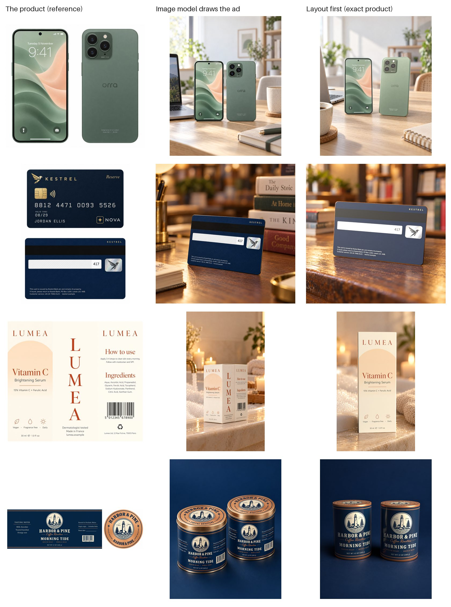

# Five products, three methods



**Short version:** an image model that draws the whole ad still wins more briefs on every product, but how often depends on the product. It copies flat things seen straight on (a phone, a card) almost perfectly. It gets things wrong when it has to bend or fold the artwork into 3D (a tin's label and lid, a carton): there it squashes the shape, puts every panel on the front and garbles curved text. Layout first never changes a product pixel (220 of 220 ads passed the pixel check), and it is only as good as its 3D model and its lighting.

## The products

| Product | What it tests | Reference the image model gets |
|---|---|---|
| Coca-Cola can (100 briefs) | The most-drawn can in the world | A competitor-library ad photo |
| Orra One phone (made up) | Flat glass faces, a lit screen, a camera island | Straight-on photos of front and back |
| Kestrel credit card (made up) | Tiny text: card number, small print | Straight-on photos of front and back |
| Lumea serum box (made up) | A tall carton with four printed sides | The flat print artwork (front, side, back panels) |
| Harbor & Pine coffee tin (made up) | A label wrapping round a cylinder, a printed lid | The flat wrap-around label and the lid |

The four made-up products were drawn once by the image model from a written brief ([examples/draw_products.py](../examples/draw_products.py)). From then on those images *are* the product: layout first builds its 3D model from them, the image model gets them as its reference, and the judges compare against them. So there's no real brand's artwork in the repo, and layout first's 3D model matches the reference exactly (on Coca-Cola it was our own rebuild of the label). Each made-up product had 30 briefs, in scenes that suit it (desks and cafés for the phone, shop counters for the card, bathrooms for the serum, kitchens for the coffee).

## Who wins

Blind judge (Gemini 3.1 Pro) sees the reference, then the three ads in random order, scores each and ranks them.

| | Coca-Cola | Phone | Card | Serum box | Coffee tin |
|---|---|---|---|---|---|
| **Ranked first**, image model / layout first | 98% / 2% | 63% / 37% | 90% / 10% | 57% / 43% | 70% / 30% |
| **Would ship**, image model / layout first | 78% / 0% | 63% / 37% | 90% / 23% | 57% / 33% | 40% / 17% |
| **Product scored 3 or less**, image model / layout first | 6% / 35% | 3% / 20% | 0% / 3% | **37%** / 20% | **37%** / 43% |
| **Realism (1-10)**, image model / layout first | 7.0 / 4.8 | 6.9 / 6.2 | 7.1 / 5.6 | 6.2 / 5.9 | 6.8 / 5.5 |
| Layout first pixel check | 100 / 100 | 30 / 30 | 30 / 30 | 30 / 30 | 30 / 30 |

Blender alone (the layout render on its plain set) won no brief anywhere. Cost per ad was about $0.09 for both image-model arms.

## How accurate is the image model's product?

A second check looks at one ad at a time against the reference, item by item: each logo, line of text and printed mark is correct, wrong, missing or not visible. Layout first's product pixels are exact by construction, so whatever the checker calls wrong on layout first is the checker's own noise (glare, small text it can't read, curved text it reads as cut off). That sets the bar the image model has to be judged against.

| | Coca-Cola | Phone | Card | Serum box | Coffee tin |
|---|---|---|---|---|---|
| Image model: ads with every item right | 40% | 100% | 100% | 87% | 20% |
| Image model: items wrong | 27% | 0% | 0% | 0% | 17% |
| Image model: ads with invented marks | 11% | 0% | 0% | 10% | 17% |
| Layout first (checker noise): items "wrong" | 57% * | 15% | 16% | 8% | 14% |

\* Our Coca-Cola can was rebuilt from the wordmark, not the real print file, so here the checker also counts our label's real differences from the photo.

What we saw, looking at the ads ourselves:

- **Flat products shown the way the reference shows them are copied exactly.** All 60 phone and card ads had every line right, down to the card's three lines of issuer small print. The image model's only phone slip was the number of side buttons.
- **Artwork that must wrap round a cylinder breaks.** On the coffee tin, 21 of 30 lids had garbled or doubled ring text ("COFEYERS", "COFASTERS", HARBOR & PINE twice), and the judge scored the product 3 or less in 11 of 30 ads, mostly because the whole wrap-around label (tasting notes and origin panels included) was squeezed onto the front, which a real tin can't show at once. On Coca-Cola, the script logo was wrong in 43 of 100 ads and "12 FL OZ" in 49.
- **Wrong shapes.** Given the carton's flat print artwork, the image model pasted two or three panels side by side across a wide, squat box in 11 of 30 serum ads (all 11 the judge scored 3 or less). The tins came out squat too. Every word was spelt right in those ads, so the item checker passed them; only the head-to-head judge caught them. A real packshot photo as reference might avoid this; flat print files are what many brands hand over, so we tested with them.
- **The item checker is lenient on shape.** It called shape right in 100% of image-model coffee and serum ads; we found clear proportion errors in several. Use the judge's "product scored 3 or less" for shape.

## Why the image model still wins most briefs

1. **It lights the product with the scene.** Layout first keeps the product as Blender lit it, and only the room around it is repainted. A studio-lit product in a candle-lit bathroom looks pasted in, and the judge marks realism down by 1-2 points every time.
2. **Materials matter, and we tuned two after the first run.** At first the card rendered slate grey instead of deep navy (the matte finish's sheen under a bright sky) and the phone's back came out paler than its photo. A soft-touch finish with almost no sheen and a lower exposure for the phone fixed most of it (see below), but the remaining gap is light, not colour.
3. **The judge forgives believable mistakes.** A squat tin with all panels on the front still looks like a great photo, and often still ranks first. A brand would reject it.
4. **Famous products are easy.** On Coca-Cola the image model has seen the can countless times. On made-up products it has only the reference, and where 3D is involved it shows.

## Fixing the card and phone materials

The first run of the card and phone used a matte finish whose sheen turned the printed navy (RGB about 14, 27, 44) into grey-blue (about 70-110) under a bright sky, and lit the phone's back about 1.4 times brighter than its photo. We added a `soft_touch` finish (almost no sheen), turned the phone's exposure down 0.4 stops and its frosted glass's sheen down, and reran only Blender and layout first (the image model's ads and prompts were unchanged):

| | Card, before → after | Phone, before → after |
|---|---|---|
| Layout first product scored 3 or less | 28% → **3%** | 20% → 20% |
| Layout first product score (1-10) | 4.6 → **5.6** | 5.4 → 5.6 |
| Layout first realism | 5.1 → 5.6 | 6.1 → 6.2 |
| Layout first would ship | 10% → 23% | 40% → 37% |
| Layout first ranked first | 10% → 10% | 33% → 37% |
| Checker: card colour right | 40% → 80% | 90% → 97% |

The card's product complaints mostly went away. It still loses the ranking on light: the image model's card sits in the scene's light, ours in Blender's.

## Relighting tests: both made things worse

The obvious fix for "the product keeps Blender's light" was to light it like the room. `shots relight` does that after the repaint: Gemini reads the repainted room's light (direction, height, colour, hardness, how open the shadows are), the repaint becomes a blurred panorama the product reflects, and Blender renders the product again under that light. A back-lit room keeps its light on the same side but brought round to the front, so the label still reads. The repaint is reused, so the product pixels still come only from the 3D model, and all 60 relit ads passed the pixel check.

Judged three ways (image model, layout first, relit) on the card and the coffee tin, 30 briefs each:

| | Card: layout first / relit | Coffee tin: layout first / relit |
|---|---|---|
| Ranked first | 17% / **3%** | 17% / **7%** |
| Product score (1-10) | 5.2 / 4.5 | 4.1 / 3.8 |
| Realism (1-10) | 5.2 / 5.1 | 5.1 / 4.7 |
| Pixel check | 30 / 30 | 30 / 30 |

Relit lost on both. The judge's notes say why: "severe colour tinting makes the magnetic stripe, signature box and hologram appear gold", "the card appears black instead of navy", "impossible bright reflections". Warm room light does turn a white strip gold, physically; but in an ad it reads as the wrong product. The image model keeps the product's printed colours true even in a candle-lit restaurant or a taxi at night, which is what product photographers do: neutral light on the product, the room shown through rim light, shadow and reflection. So we tried again in white light: `shots relight --neutral` keeps the room's light direction, height, softness and strength, but the light is white and the room it reflects is grey, so printed colours stay true.

| | Card: layout first / neutral relit | Coffee tin: layout first / neutral relit |
|---|---|---|
| Ranked first | 13% / **3%** | 13% / **3%** |
| Product score (1-10) | 5.4 / 5.0 | 3.6 / 3.5 |
| Realism (1-10) | 5.4 / 5.3 | 5.0 / 4.5 |
| Pixel check | 30 / 30 | 30 / 30 |

That lost too. The colour complaints went away, and new ones came in: "harsh, artificial-looking reflection obscures the brand name", "obvious 3D renders with harsh, unnatural reflections". The room's reflection on the metal tin read as CG, and the stronger directional light made edges glint.

**What this tells us:** the plain, soft studio light Blender already uses beat both attempts to match the room. Matching the room's light is not what layout first is missing. The gap to the image model is in how the product reads as photographed: soft, believable material response, contact with the surface, framing. Note also how much the judge's numbers move between comparisons: the same layout-first ads scored 3.6 to 4.1 on coffee product depending on what they were judged against, so differences under about half a point are noise.

`shots relight` (and `--neutral`) stay in the repo as experiments, off by default. Results: `results/demo-card/relit/`, `results/demo-coffee/relit/` and the `relit_neutral/` folders beside them.

## What would close the gap

- **Check the material before making ads:** render the product under a few bench lights and compare its printed colours with the reference automatically. The card's grey would have been caught before any money was spent.
- **Integration rather than light** (relighting is ruled out above): contact shadows and reflections on the surface the product stands on, hero framing that fills the frame, and styling layers in 3D (condensation, reflections).

## Reproduce

```bash
.venv/bin/shots product-check demo-phone
.venv/bin/shots bench briefs demo-phone --n 30
.venv/bin/shots bench run demo-phone --workers 4
.venv/bin/shots bench judge demo-phone
.venv/bin/shots bench accuracy demo-phone
.venv/bin/shots bench report demo-phone --out results/demo-phone
```

The same for `demo-card`, `demo-serum` and `demo-coffee`. Numbers per product are in `results/<product>/summary.json`, with example sheets in `results/<product>/examples/`. The Coca-Cola details are in [coca-cola/report.md](coca-cola/report.md). Running all four products cost about $30: about $22 for the ads, the rest for drawing the products and the judge and checker calls.
